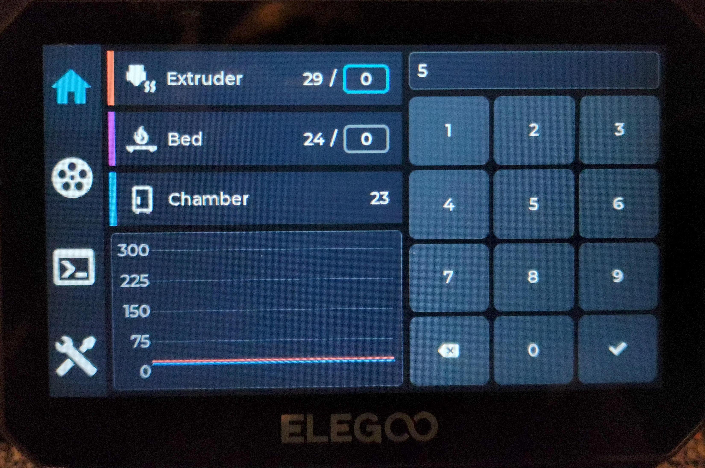
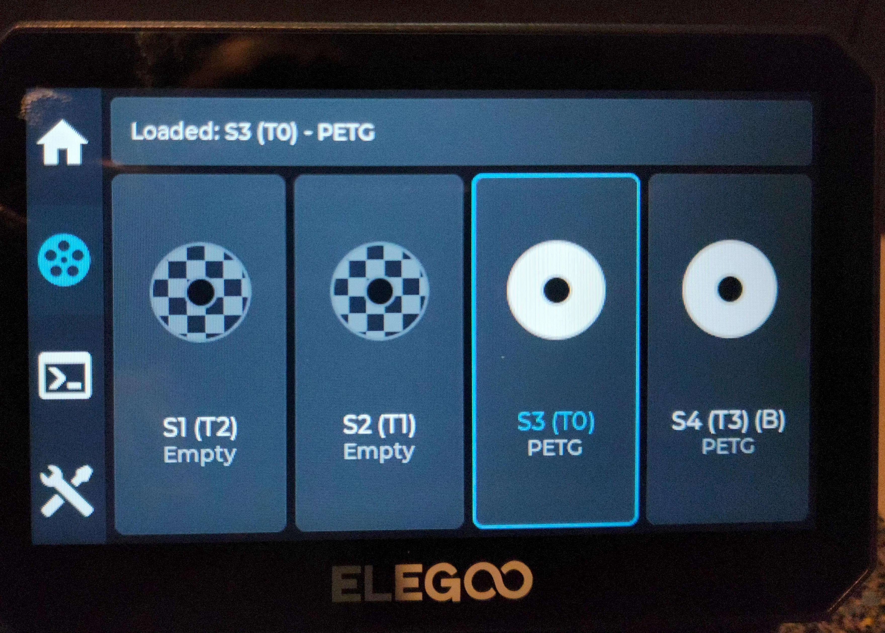

# Grumpyscreen Themes

This repository contains themes for [Grumpyscreen](https://github.com/PONOdata/grumpyscreen).

## Supported firmware

| Firmware | Supported printer |
| --- | --- |
| COSMOS | Elegoo Centauri Carbon 2 & Centauri Carbon |

## Themes

1. [Carbon Cosmos](https://github.com/Misunderstood-Wookiee/Grumpyscreen_Themes/blob/cff5cd2627e2069a98579388898c86fc1a296512/COSMOS/grumpyscreen.cfg) — COSMOS theme for the Elegoo Centauri Carbon lineup running COSMOS firmware.

### Carbon Cosmos screenshots

| Temperature controls | Filament slots |
| --- | --- |
|  |  |
